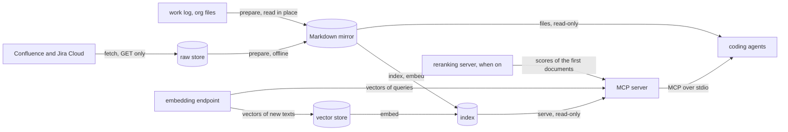

# Internals

How the program turns its sources into answers for agents: Confluence and Jira, on the
site, and the user's work log, a folder of org files on this machine
([sources](sources.md) says why these three are put together as they are). Five [stages](../reference/glossary.md#stage),
each a command that the user composes, each reading what an earlier one wrote. Of the
stages, only `fetch` reads the site; every later one can be run again offline, from what
is on the disk. This page follows the data through them, then follows one change, from a
page edited on the site, or an entry of the work log closed, to the next search. The
formats of what each stage writes are in [the data layout](../reference/data-layout.md);
where the code of each lives, in [the code's layout](code-layout.md), and the code itself,
step by step, in [the walkthrough](code-walkthrough.md); why it is built so, in [the
trade-offs](trade-offs.md).

| Stage | Reads | Writes | Never half-written, by | When one thing fails |
|---|---|---|---|---|
| `fetch` | the site, GET only | `<data>/raw/` | a lock, and each snapshot renamed into place | the document is counted and skipped; the run goes on |
| `prepare` | the raw store | `<data>/docs/`, `<data>/conversions.sqlite` | each file renamed into place, each conversion committed as it is made | the document is reported, its last good file kept; a damaged cache is replaced |
| `prepare`, of the work log | its folder, in place | `<data>/docs/worklog/` | each file renamed into place | the file or document is named by its path; no file is removed but the old one of a document written again under another title's path |
| `index` | the index; the mirror, each file digested and those changed read; the user's alias file, if any | `<data>/index.sqlite`, only when something changed | the index built aside, what did not change copied from the old, then renamed into place under the index's lock | the file is skipped and named; a name that could be several people is joined to none, and named; with an alias file refused, the old index stays |
| `embed` | the index; the mirror's digests alone; the endpoint, for new texts | `<data>/index.sqlite`, only when its pieces or model changed, `<data>/vectors.sqlite` | as `index`, the index copied whole aside; the vector store pruned under its own lock, its deletions one transaction | a piece refused is named and asked again; without the endpoint, or with an index of another cut, the old index stays; a prune it cannot trust deletes nothing |
| `serve` | the index; the endpoint, for queries; the reranking server, when on | nothing | the index opened read-only for each call | without meaning, the search ranks by words and says why; without the reranker, it keeps its order and says why |

## The stages, each one command

A refresh is what the user composes: `fetch`, each source taken that has a fetcher, a
fetch of the spaces or projects that its table names
([`run_fetch`](../../src/kb_mcp/sources/atlassian/fetch/app/fetching.py)); `prepare`, each
source's preparer, [`prepare_atlassian`](../../src/kb_mcp/sources/atlassian/prepare/app/prepare.py) for
Confluence's and Jira's,
[`prepare_worklog`](../../src/kb_mcp/sources/worklog/prepare/app/prepare.py) for the work log;
`index`, the words of the mirror's files that changed, whichever sources were prepared
([`update_index`](../../src/kb_mcp/search/app/indexing.py)); and `embed`, the vectors of
the pieces that the index lacks, then the prune
([`fill_and_prune`](../../src/kb_mcp/search/app/indexing.py)). `fetch` and `prepare` share one
use case ([`run_each`](../../src/kb_mcp/cli/app/sources.py)). A [source](../reference/glossary.md#source)'s declaration
names its table, its fetcher and its preparers ([`SOURCES`](../../src/kb_mcp/sources/registry.py)), and the
names given choose among those that a command can take
([`chosen`](../../src/kb_mcp/cli/domain/sources.py));
[sources](sources.md#three-stages-not-a-bundle) says why a source is put together so.

- **Writes** what each stage writes, as the sections below say.
- **One row's failure** stops no other: each fetcher or preparer reads what is on disk, and
  the next command reads what the last one left, so that the work log is prepared while the
  site asks
  to sign in again. What can be refused is refused before the first row: a space or
  project with nowhere to start
  ([`PeriodError`](../../src/kb_mcp/sources/atlassian/fetch/domain/period.py)),
  or a work log that is not a folder
  ([`SourcesRefusedError`](../../src/kb_mcp/cli/app/sources.py)). Ctrl-C ends
  the row it stops and runs no later one. The exit status ranks how the rows ended:
  interrupted, then to sign in again, then failed
  ([`RANKED`](../../src/kb_mcp/cli/domain/rows.py)).
- **Offline**, all but `fetch`: `prepare`, `index` and `embed` read nothing from the site.

## Fetch: from the site to the raw store

[`run_fetch`](../../src/kb_mcp/sources/atlassian/fetch/app/fetching.py) reads the
site through one port, [`SiteClient`](../../src/kb_mcp/sources/atlassian/fetch/adapters/http.py),
which makes GETs alone, one at a time and paced, signed in by the saved session or an API
token ([`choose_sign_in`](../../src/kb_mcp/sources/atlassian/fetch/adapters/sign_in.py)).
For each Confluence space, it lists every page, blog post and folder, and stores the
listings whole; for each Jira project, it searches the issues updated in its window. Then
it fetches each document updated in the window whose revision the store lacks
([`Fetching.fetch_listed`](../../src/kb_mcp/sources/atlassian/fetch/app/fetching.py)),
its files first, the snapshot last
([`Fetching.keep`](../../src/kb_mcp/sources/atlassian/fetch/app/fetching.py)),
and counts what it fetches apart from what it lists. Without `--since`, each target
fetches what changed since its last fetch
([`fetch_window`](../../src/kb_mcp/sources/atlassian/fetch/domain/coverage.py)): a
project from a day before the end of the period it covers, which ends at its earliest
document not stored whole, so that a run asks for that again; a space from the start of
that period, its listing being read whole anyway; a target never fetched, its last 7
days. A catch-up that would start after `--until` skips its target.

- **Writes**, into `<data>/raw/` alone, through
  [`RawStore`](../../src/kb_mcp/sources/atlassian/fetch/adapters/raw_store.py):
  snapshots, listings, files by digest, the coverage and the tombstones of documents
  gone. One run at a time:
  [`RawStore.writing`](../../src/kb_mcp/sources/atlassian/fetch/adapters/raw_store.py)
  holds a lock, and a second run stops at once with
  [`StoreBusyError`](../../src/kb_mcp/sources/atlassian/fetch/adapters/raw_store.py).
  A snapshot is written into a hidden folder and renamed into place
  ([`RawStore.put`](../../src/kb_mcp/sources/atlassian/fetch/adapters/raw_store.py)):
  complete or absent. Its responses are never written again; its record gains the files
  that a later run fetches, such as one that failed
  ([`RawStore.add_blobs`](../../src/kb_mcp/sources/atlassian/fetch/adapters/raw_store.py)).
- **One document's failure** is counted, logged with its id, and skipped; the run goes
  on. A response that its adapter refuses is stored all the same, raw, for a fixed
  adapter to read. Only ten GETs in a row without an answer
  ([`MAX_FAILED_IN_A_ROW`](../../src/kb_mcp/sources/atlassian/fetch/adapters/http.py)),
  or a session that no longer holds
  ([`SignInNeededError`](../../src/kb_mcp/sources/atlassian/fetch/adapters/http.py)),
  stop a run; its report is saved even then.
- **Offline**, nothing: this is the one stage that reads the site.

## Prepare: from the raw store to Markdown

[`prepare_atlassian`](../../src/kb_mcp/sources/atlassian/prepare/app/prepare.py) reads the newest
snapshot of each document
([`RawStore.latest`](../../src/kb_mcp/sources/atlassian/fetch/adapters/raw_store.py)),
the listings, the users and the tombstones, and the setting `accounts.atlassian.site`:
nothing else shapes its files. Confluence and Jira are prepared apart, Confluence first,
each its own kinds, and each places every document, since a page links an issue, and an
issue a page. It places each document in the space whose freshest listing names it,
leaving out those confirmed gone
([`place`](../../src/kb_mcp/sources/atlassian/prepare/app/prepare.py)); for its own, it turns the site's HTML
into plain HTML, the one module that knows the site's markup
([`normalise`](../../src/kb_mcp/sources/atlassian/prepare/adapters/site_html.py)); and has
pandoc write it as Markdown, one process a document
([`Pandoc.markdown`](../../src/kb_mcp/mirror/adapters/pandoc.py)), unless
that HTML was converted before.

Pandoc's conversions are kept in `<data>/conversions.sqlite`, which each prepare opens
on its own source's rows
([`opened`](../../src/kb_mcp/mirror/adapters/conversions.py)). Each is
kept under a key that holds the whole of pandoc's input: its version line and its
arguments ([`Pandoc.html_converter`](../../src/kb_mcp/mirror/adapters/pandoc.py)),
then the HTML
([`Conversions.markdown`](../../src/kb_mcp/mirror/adapters/conversions.py)).
With `--sandbox`, pandoc reads nothing else, so a conversion kept cannot go stale. What
else a file depends on is either inside that HTML, which each run builds afresh from the
store and the settings, such as a link made relative or a user's name, or in the front
matter, which is written after pandoc. So a run converts only the HTML that it has not
converted before, and writes the same bytes as a run without the cache; reading the
store and building the HTML are what remain ([the
trade-offs](trade-offs.md#pandocs-conversions-kept-by-their-input) give the cost).

- **Writes**, into `<data>/docs/` alone, through
  [`write_changed`](../../src/kb_mcp/mirror/adapters/mirror_files.py): each file
  whose bytes differ, through a hidden file renamed into place, so that no reader sees
  half of one. A file whose bytes are the same keeps them and its time. No lock: the
  snapshots read are each complete, and each file is replaced whole. Each source writes
  and removes under its own folder
  ([`owned`](../../src/kb_mcp/sources/atlassian/prepare/adapters/owned.py)), and
  `docs/assets/` is theirs together
  ([`attached`](../../src/kb_mcp/sources/atlassian/prepare/adapters/owned.py)). Into
  `<data>/conversions.sqlite`, each conversion as soon as it is made, so that an
  interrupted run keeps those it made; once the files are written, the conversions of
  its source that the run did not use are deleted, unless it reported anything
  ([`Conversions.drop_unused`](../../src/kb_mcp/mirror/adapters/conversions.py)).
- **One document's failure**, a field refused or pandoc failing, is reported by its place
  in the store, never its content; the run goes on. A source that reported anything
  removes no file of its own but those of documents gone or moved, and no conversion, so
  that the last good copy of each stays; the other source's removals go on, but under
  `docs/assets/`, where any snapshot or listing not read stops them, since the files
  wanted are then unknown. A cache that SQLite finds damaged, or no database at all, is
  deleted and started empty, with a warning, and the run converts everything
  ([`opened`](../../src/kb_mcp/mirror/adapters/conversions.py)).
- **Offline**, everything: the mirror is rebuilt from the raw store, byte for byte, as
  long as pandoc's version is the same.

## The work log: from org files to Markdown

[`prepare_worklog`](../../src/kb_mcp/sources/worklog/prepare/app/prepare.py), the work log's
row of `prepare`, reads its folder in place and never writes there, following a link
only inside it ([`listed`](../../src/kb_mcp/sources/worklog/prepare/adapters/files.py)).
It has no raw store: its files are already on this machine, and reading them whole costs
less than keeping a copy. They become documents, one per day of the journal, one per
meeting of a day, one per other top-level entry of `todo.org` and of its archive
([`journal`](../../src/kb_mcp/sources/worklog/prepare/domain/worklog.py)), and one
per transcript
([`transcripts`](../../src/kb_mcp/sources/worklog/prepare/domain/worklog.py)), each
with an id that org's own edits leave alone. A document's revision is a digest of what
pandoc reads, with pandoc's version and options
([`revision`](../../src/kb_mcp/sources/worklog/prepare/domain/worklog.py),
[`Pandoc.org_converter`](../../src/kb_mcp/mirror/adapters/pandoc.py)): a
document whose file holds that revision keeps its body and its dates, but a day, a meeting
or a dated transcript, dated afresh by its day; another is converted again
([`Pandoc.org_markdown`](../../src/kb_mcp/mirror/adapters/pandoc.py)).

- **Writes**, into `<data>/docs/worklog/` alone, through the mirror's
  [`write_changed`](../../src/kb_mcp/mirror/adapters/mirror_files.py): each file
  whose bytes differ, renamed into place, and the files of documents gone removed
  ([`worklog_owned`](../../src/kb_mcp/sources/worklog/prepare/adapters/owned.py)).
- **One document's failure**, a file that links out of the folder
  ([`listed`](../../src/kb_mcp/sources/worklog/prepare/adapters/files.py)), is
  over 32 MiB or is not UTF-8
  ([`org_text`](../../src/kb_mcp/sources/worklog/prepare/adapters/files.py)), or a
  conversion that fails, is named by its path, never by its content, with what it holds
  back ([`held_back`](../../src/kb_mcp/sources/worklog/prepare/domain/worklog.py));
  the run goes on, writes no file that a file not read builds, every one for `todo.org`
  or its archive, else that file's own
  ([`writable`](../../src/kb_mcp/sources/worklog/prepare/domain/worklog.py)),
  and then removes no file but the old one of a document written again under another
  title's path, so that the last good copy of each stays.
- **Offline**, everything: the work log is on this machine.

## Index and embed: from Markdown to words and vectors

[`update_index`](../../src/kb_mcp/search/app/indexing.py), `index`'s, reads the files
of the mirror alone, never the raw store (an import contract holds it): every source's
alike, by one rule of which files are documents
([`documents`](../../src/kb_mcp/mirror/adapters/markdown.py)). It digests each file and
compares it with what the index holds
([`change_of`](../../src/kb_mcp/search/app/indexing.py)), reads only those added or
changed, cuts each body into sections before each heading
([`sections`](../../src/kb_mcp/search/domain/search.py)), and indexes them by words.
[`fill_and_prune`](../../src/kb_mcp/search/app/indexing.py), `embed`'s, reads the index alone,
cuts each document's body again into pieces by the setting `chunking`
([`CHUNKERS`](../../src/kb_mcp/search/domain/chunking.py)), and gives a vector to each
piece that the index lacks
([`filling`](../../src/kb_mcp/search/app/indexing.py)).

- **Writes** a new `<data>/index.sqlite` in a file beside the old one, renamed into
  place once complete ([`aside`](../../src/kb_mcp/search/adapters/sqlite_index.py)); on
  any failure, the old index stays. `index` copies into it, from the old one attached
  read-only, every document whose file did not change, with its sections and pieces, and
  adds those read ([`Writer.update`](../../src/kb_mcp/search/adapters/sqlite_index.py));
  `embed` copies the old one whole, by SQLite's backup, and adds and removes pieces
  ([`SqliteIndex.fill`](../../src/kb_mcp/search/adapters/sqlite_index.py)). With nothing
  changed, neither writes. Each holds the index's lock, `<data>/index.sqlite.lock`, from
  its check that the index is still the build it read until the rename, and starts again
  once when another run wrote it meanwhile
  ([`SqliteIndex.update`](../../src/kb_mcp/search/adapters/sqlite_index.py)). Each write
  has a random id, its meta row `build`. Vectors are kept in `<data>/vectors.sqlite`,
  committed 256 texts at a time
  ([`VectorStore.vectors`](../../src/kb_mcp/search/adapters/vector_store.py)), so that
  an interrupted `embed` loses little; in SQLite's WAL mode, an `embed` and an `eval`
  can share it, a write waiting for the other's
  ([`opened`](../../src/kb_mcp/search/adapters/vector_store.py)). `embed` holds the
  store's lock shared from its read of the vectors until its index is in place
  ([`shared`](../../src/kb_mcp/search/adapters/vector_store.py)); then `fill_and_prune` prunes
  the store (below).
- **Joins** the documents' people into persons, at each write of `index`, over every
  document, those copied included, in the same transaction
  ([`Writer.join`](../../src/kb_mcp/search/adapters/sqlite_index.py)):
  each row of `people` is given its person by the rules of
  [`joined`](../../src/kb_mcp/search/domain/people.py), through the
  aliases of `<data>/aliases.toml`, which `index` reads first, before the mirror
  ([`update_index`](../../src/kb_mcp/search/app/indexing.py)); the
  persons and their names go into tables of their own, which the filters by person read.
  A transcript's meetings, which a speaker may join by, are the meetings that its
  `summary` links name, read by their source and id; the join is a span of its own.
  The join is whole at each write: one account indexed late can make a name of the work
  log ambiguous
  ([sources](sources.md#one-person-across-sources) says why persons are joined so).
  `embed` joins nothing.
- **One document's failure**, a file not UTF-8, front matter refused, or a second
  document of the same source and id, skips that file and names it, with a reason that
  holds no content, at each run, as the index records it; the update completes and
  exits 1. A piece whose text the endpoint refuses is left without a vector, its
  document named, and asked again at the next `embed`. A name that could be several
  persons, or an alias that changes nothing, is a warning, once a build, and the exit
  status stays. Only an alias file that cannot be read or is refused stops `index`, and
  an endpoint that does not answer, or lacks the model, or an index that another
  version of `WORDS` wrote or that is damaged, stops `embed`: the old index stays.
- **Offline**, the words and the persons: the index is updated from the mirror and the
  alias file alone. Meaning needs the endpoint, but only for texts that the vector store
  lacks (below).

## Serve: from the index to agents

The server ([`run`](../../src/kb_mcp/cli/commands/serve.py)) answers the
tools of [`Library`](../../src/kb_mcp/mcp/app/tools.py) over stdio. It
writes nothing. Each call opens the index read-only for itself
([`reading`](../../src/kb_mcp/search/adapters/sqlite_index.py)), so a new
build is read from the next call on, and each answer stays within its budget, with what
it copies from the site inside a block marked as untrusted
([`answer`](../../src/kb_mcp/mcp/app/responses.py)). In the lexical mode
it never opens the endpoint. A search ranks in the mode that `search_mode` sets
([`ranking`](../../src/kb_mcp/mcp/app/tools.py)); issue keys and page ids
named in a query put their documents first, in every mode.

### By words

The query becomes words ([`plan_query`](../../src/kb_mcp/search/domain/search.py)):
split, in lower case, without the English and French stop words unless nothing else is
left, at most ten, each a quoted string, so that nothing a query holds is read as an
operator; and the whole phrase too, when it has 2 to 16 words. For each word, and the
phrase, the index scores each document that matches by its best section's bm25, with
weights per column, the title first
([`Reader.scores`](../../src/kb_mcp/search/adapters/sqlite_index.py));
a document's score is the sum of its scores
([`rank`](../../src/kb_mcp/search/domain/search.py)).

### By meaning

The query is embedded, with the model's query prefix, and compared with every piece of
the index: the vectors are of unit length, so one product of the matrix of pieces by the
query gives every cosine, exactly, with no approximate index
([`Pieces.nearest`](../../src/kb_mcp/search/domain/search.py)). A document
scores by its best piece, and the 100 nearest are kept
([`Meaning.nearest`](../../src/kb_mcp/search/app/meaning.py)). The model
is the one the index names, never the setting, and only while the endpoint's fingerprint
for it is the index's: vectors of other weights would not compare with the query's.

### Fused

In the hybrid mode, the default, the two rankings are fused by reciprocal rank: each
list gives a document 1 / (60 + its rank), and the sums order them
([`fuse`](../../src/kb_mcp/search/domain/search.py)). Ranks, not scores,
are added, as a bm25 and a cosine have no common scale. A document is shown by the
section of whichever list ranks it higher.

### Falling back to words

When meaning cannot be searched, a search in the hybrid or semantic mode ranks by words
alone, and its answer says why, never failing
([`ranking`](../../src/kb_mcp/mcp/app/tools.py)): the index holds no
vectors ([`NO_VECTORS`](../../src/kb_mcp/search/app/meaning.py)), it was
built with other weights of its model
([`STALE`](../../src/kb_mcp/search/app/meaning.py)), or the endpoint does
not answer or lacks the model. A failed connection is not tried again for 30 seconds
([`QUIET_S`](../../src/kb_mcp/search/app/meaning.py)), so that searches in
the meantime answer at once.

### Reranked

Reranking is off by default. Turned on, unless the search is sorted by a date, the
documents after those that the query names, as many as `rerank.depth`, 30 by default,
go with the query to the reranking server, each as its title, the heading of its
section and 1,200 characters about its best place
([`reranked`](../../src/kb_mcp/mcp/app/tools.py)). The server scores each
pair, and they are shown in the order of its scores, the rest after them in their own
([`Reranking.reorder`](../../src/kb_mcp/search/app/reranking.py)). One
adapter knows the server's API
([`rerank`](../../src/kb_mcp/search/adapters/reranking.py)); a search
makes one attempt, within 30 seconds. A cursor carries the order, so that a next page
asks nothing ([`written`](../../src/kb_mcp/search/domain/reranking.py)).
When the server does not answer, or answers amiss, the search keeps its order and says
why, and the server is not asked again for 30 seconds; a refused request is that
search's alone. [Reranking](reranking.md) says why, at what cost, and why it is off.

## How a change reaches search

Follow one page, edited on the site, to the answers of the next search, and beside it
one entry of the work log, closed in `todo.org`. Nothing in the program watches for
changes: `fetch`, `prepare`, `index` and `embed`, each run by hand, take the steps below.

### 1. A new snapshot, or a tombstone

An edit gives the page a new version. The next `fetch` lists its space whole, finds
the page updated within the period it covers, sees that this revision is not stored
([`RawStore.has`](../../src/kb_mcp/sources/atlassian/fetch/adapters/raw_store.py)),
and fetches it as a new snapshot, beside the old one, which stays. An issue edited in
Jira has a new update time, its revision, and is fetched the same way.

- **Moved** to another space that the run keeps, a page is listed there, and the store
  notes when each space was listed.
- **Deleted**, a page is absent from its space's listing. The run records a
  [`Tombstone`](../../src/kb_mcp/sources/atlassian/fetch/domain/deletions.py) and
  probes the page; a second answer of gone, an hour or more after the first, confirms
  it. When many probes of one space answer that their pages are gone, the run first
  checks that its session still holds
  ([`too_many_gone`](../../src/kb_mcp/sources/atlassian/fetch/domain/deletions.py)),
  so that a lost session deletes nothing.
- **Not yet seen**: a change that makes no new version, such as labels changed or a
  file attached without an edit, and Jira's deletions; [the data
  layout](../reference/data-layout.md#snapshots) lists these limits.
- **A work-log entry closed** makes no snapshot: the work log has no raw store, and
  `prepare` reads its folder whole at each run (below).

### 2. The mirror's file rewritten or removed

`prepare` builds every file again from the newest snapshot of each document, and writes
only those whose bytes changed: the edited page's file is replaced whole, and every
other file keeps its bytes and its time. A changed title renames the file, as its name
holds the title, and the old name goes. A moved page's file goes to its new space's
folder. A confirmed deletion removes the file, even in a run that reports problems with
other documents.

Building every file again costs pandoc only what changed. Each document's HTML is built
anew, then looked up in the cache of conversions by its key
([`Conversions.markdown`](../../src/kb_mcp/mirror/adapters/conversions.py)):
the edited page's new body is converted, and every other document's, the same string as
at the last run, is reused. What an edit reaches beyond its own page lies in that HTML
too, and is converted again where it shows: a new title, in the page's own heading, in
the space's tree and in each link that leads to its renamed file; a page stored for the
first time, in the links to it, now relative, and in the tree; a user's name changed in
the store's users, in the headings of that user's comments. A child's breadcrumb is in
its front matter, written after pandoc, and costs no conversion. The edited page's old
conversion is deleted once the files are written, with those of documents gone, unless
the run reported a problem
([`Conversions.drop_unused`](../../src/kb_mcp/mirror/adapters/conversions.py)).

The work log's row does the same from the folder itself. Closing an entry turns its
keyword to `DONE`, or another that means done, and adds a `CLOSED:` line under its
heading. Its id is taken from its `:ID:`, else its title and `:CREATED:`, else its
title, never from its keyword or planning lines
([`journal`](../../src/kb_mcp/sources/worklog/prepare/domain/worklog.py)), so its
file keeps its name. Its text changed, so its revision did
([`revision`](../../src/kb_mcp/sources/worklog/prepare/domain/worklog.py)): the
entry is converted again, its `status` becomes `DONE`, and its `updated` the latest of
its timestamps up to the file's time of change, usually the closing one
([`WorklogDocument.dates`](../../src/kb_mcp/sources/worklog/prepare/domain/worklog.py)).
Every other entry keeps its file as it was, dates included, though `todo.org`'s time
changed ([`prepare_worklog`](../../src/kb_mcp/sources/worklog/prepare/app/prepare.py)). An
entry archived to `todo.org_archive` keeps its id too: its file is rewritten, labelled
`ARCHIVE`, or removed when `archives = false`;
[sources](sources.md#identity-that-survives-orgs-edits) says why identity is kept so.

### 3. The index updated aside, then renamed in

`index` patches nothing in place. It digests every file of the mirror and compares each
with the digest that the index records
([`change_of`](../../src/kb_mcp/search/app/indexing.py)): with no file added, changed or
gone, and the same alias file, it writes nothing. Else it reads the files added or
changed, then builds a new index beside the old one
([`Writer.update`](../../src/kb_mcp/search/adapters/sqlite_index.py)): every document
whose file did not change is copied with its sections and pieces, and so with its
vectors; the edited page is read again, and put in place of its old document, with no
pieces; a deleted page's document is left out, its sections and pieces with it, and a
renamed file is one document removed and one added. FTS5's index is rebuilt from the
sections, persons are joined again over every document, and the file is renamed into
place under the index's lock
([`SqliteIndex.update`](../../src/kb_mcp/search/adapters/sqlite_index.py)). So nothing
stale is left in the index, and a run that fails leaves the old one whole. An index that
cannot be updated, written before plan 035 or by another version of `WORDS`, damaged,
or on `index --rebuild`, is rebuilt whole, with no pieces.

Until `embed` runs, the edited page has no vectors: search finds its new text by words,
and misses it by meaning, and `index` counts the documents awaiting vectors. `embed`
reads the index in one use ([`to_fill`](../../src/kb_mcp/search/app/indexing.py)), cuts
each document's body again into the pieces that the run's chunking and model want, and
compares them with those that the index holds
([`filling`](../../src/kb_mcp/search/app/indexing.py)): it adds the edited page's,
removes those that no section wants, and writes them into a copy of the index, renamed
in its turn ([`SqliteIndex.fill`](../../src/kb_mcp/search/adapters/sqlite_index.py));
with nothing to add or remove, it writes nothing. It reads the mirror's files for their
digests alone, compares them with the index's, and when they differ warns, naming
`kb-mcp index`, then goes on: a chain that leaves out `index` fills the index as it was,
and the server goes on serving the edited page's old text, and the deleted page, until
the next `index` ([the trade-offs](trade-offs.md#the-index-updated-aside-not-in-place)
say why).

### 4. Vectors reused by the key of model and text

Each piece is embedded as a text that its chunking composes: by `windows`, the default,
the document's title and the window
([`windows`](../../src/kb_mcp/search/domain/chunking.py)). Its vector is
kept under a key, the SHA-256 of the model's fingerprint and that text
([`vector_key`](../../src/kb_mcp/search/adapters/vector_store.py)). `embed` asks
the vector store for the key of each piece that the index lacks, and the endpoint for
the texts that the store lacks alone. So a piece whose text did not change is never
embedded again, and one that the index holds is not even looked up: a page moved to
another space keeps its vectors, unless its chunking embeds the breadcrumb that the move
changed. What widens the texts embedded again:

- **A chunking whose cuts shift.** `windows` cut the whole body at fixed steps from its
  start, so an edit shifts every window after it, all new texts, while the windows
  before it are reused. `sections`, `section-paths` and `small-to-big` cut each section
  apart, so an edit re-embeds the pieces of its own section. Closing a work-log entry
  writes its `CLOSED:` line just under its heading, so by `windows` nearly every piece
  of that entry is new, and no other entry's.
- **A renamed title or heading.** Each piece's text begins with the title, so a new
  title re-embeds the whole page. A renamed heading re-embeds the windows from it on by
  `windows`; its section's pieces by `sections`; and by `section-paths` and
  `small-to-big`, whose texts carry the breadcrumb and the path of headings, the pieces
  of its section and of every section under it, and every piece of a page whose
  breadcrumb changes.
- **Another chunking**, which cuts other texts: the first `embed` after changing
  `chunking` embeds the whole mirror, unless an `eval` of that chunking with the same
  model embedded it already.
- **Another model, or new weights.** The fingerprint
  ([`ApiEmbedder.fingerprint`](../../src/kb_mcp/search/adapters/embedding.py))
  holds the model's name, the digest that Ollama lists for it, its dimensions, its
  prefixes and the adapter's format, so a change to any of them makes every key new. A
  server other than Ollama, any other OpenAI-compatible one, lists no digest: after
  changing the weights behind a name there, delete the vector store, then run
  `index --rebuild` and `embed`, as the index holds each piece under the same key.

[Chunking](chunking.md#when-pages-change) counts what one edit costs by each chunking on
the sandbox's mirror.

### 5. The server picks up the new build

The server needs no restart. Each call opens the index anew, so the call after the
rename reads the new build. The index's handle keeps the vectors of one build in memory
([`SqliteIndex`](../../src/kb_mcp/search/adapters/sqlite_index.py)), and a search by
meaning its connection to the model
([`Meaning.prepared`](../../src/kb_mcp/search/app/meaning.py)), each made again when the
build's id changes, as each write of `index` or `embed` gives a new one. A cursor
given by the old build is refused, with the advice to call again without it
([`start_of`](../../src/kb_mcp/mcp/app/tools.py)). After `ollama pull`
of new weights, a server that connects finds the fingerprint changed and answers by words
until `embed` runs, while one connected before the pull goes on with the new weights
against the old vectors until the index's next build.

### 6. The vector store pruned

After each `embed`,
[`prune`](../../src/kb_mcp/search/app/pruning.py) keeps in
`<data>/vectors.sqlite` the vectors that the indexes on disk read, by the keys their
pieces record: the index in place, the one that `embed` wrote, should an `index` have
renamed another in meanwhile, and those that `eval` keeps under
`<data>/eval/indexes/`, so that the next evaluation embeds nothing again. The vectors of
deleted pages, of texts since edited, and of chunkings and models that no index uses
go. It takes the store's lock exclusive, or waits for the next `embed` while a build
holds it, so that no build loses what it embedded; and it deletes nothing while the
index lacks a file of the mirror or holds no document, or while an index there cannot
say what it reads. A store made from plan 023 on gives the space freed back to the file
system ([`VectorStore.prune`](../../src/kb_mcp/search/adapters/vector_store.py));
one made before is converted at its first prune, by one `VACUUM`. A vector of the
default model takes about 4.7 KB on disk. Deleting `<data>/vectors.sqlite` costs
nothing at the next `embed`, as the index holds its own copy of each vector, but one
embedding of the mirror, by the model, once a whole rebuild of the index has dropped its
pieces; it downloads nothing, and the server goes on answering meanwhile.
[The data layout](../reference/data-layout.md) gives the rules.
