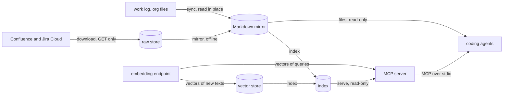

# Internals

How the program turns its sources into answers for agents: Confluence and Jira, on the
site, and the user's work log, a folder of org files on this machine
([sources](sources.md) says why these three are put together as they are). Four stages,
each a command, each reading what the one before it wrote; `sync` runs the first three
in turn, with the work log's own step, in one command. Of the stages, only `download`
reads the site; every later one can be run again offline, from what is on the disk. This
page follows the data through them, then follows one change, from a page edited on the
site, or an entry of the work log closed, to the next search. The formats of what each
stage writes are in [the data layout](../reference/data-layout.md); where the code of
each lives, in [the code's layout](code-layout.md), and the code itself, step by step,
in [the walkthrough](code-walkthrough.md); why it is built so, in [the
trade-offs](trade-offs.md).

| Stage | Reads | Writes | Never half-written, by | When one thing fails |
|---|---|---|---|---|
| `download` | the site, GET only | `<data>/raw/` | a lock, and each snapshot renamed into place | the document is counted and skipped; the run goes on |
| `mirror` | the raw store | `<data>/docs/` | each file renamed into place | the document is reported, its last good file kept |
| the work log, in `sync` | its folder, in place | `<data>/docs/worklog/` | each file renamed into place | the file or document is named by its path; no file is removed |
| `index` | the mirror; the endpoint, for new texts | `<data>/index.sqlite`, `<data>/vectors.sqlite` | the index built aside, then renamed into place; the vector store pruned under its lock, its deletions one transaction | the file is skipped and named; without the endpoint, the old index stays; a prune it cannot trust deletes nothing |
| `serve` | the index; the endpoint, for queries | nothing | the index opened read-only for each call | without meaning, the search ranks by words and says why |

## Sync: the stages in one command

[`sync`](../../src/atlassian_offline_mcp/cli/app/sync.py) runs, in this order, the stages
that a refresh needs: one download of every space and project that the settings' tables
name, then `mirror`
([`atlassian`](../../src/atlassian_offline_mcp/cli/app/sync.py)); the work log's step
([`worklog`](../../src/atlassian_offline_mcp/cli/app/sync.py)); then the index, from the
whole mirror, whichever sources the run took
([`index`](../../src/atlassian_offline_mcp/cli/app/sync.py)). Each calls the same function
as its own command:
[`download`](../../src/atlassian_offline_mcp/sources/atlassian/app/download.py),
[`mirror`](../../src/atlassian_offline_mcp/mirror/app/mirror.py),
[`mirror_worklog`](../../src/atlassian_offline_mcp/mirror/app/worklog.py) and
[`index_mirror`](../../src/atlassian_offline_mcp/search/app/indexing.py). A source is a
record that names its table and its step
([`SOURCES`](../../src/atlassian_offline_mcp/cli/domain/sync.py)), and `--include` and
`--exclude` choose among those configured
([`chosen`](../../src/atlassian_offline_mcp/cli/domain/sync.py));
[sources](sources.md#modular-and-no-more) says why no interface spans them.

- **Writes** what its stages write, each as the sections below say.
- **One step's failure** stops no other: each step reads what is on disk, so the work
  log is mirrored while the site asks to sign in again, and the index is built from what
  the mirror holds. What can be refused is refused before the first step: a space or
  project with nowhere to start
  ([`PeriodError`](../../src/atlassian_offline_mcp/sources/atlassian/domain/period.py)),
  or a work log that is not a folder
  ([`SyncRefusedError`](../../src/atlassian_offline_mcp/cli/app/sync.py)). Ctrl-C ends
  the step it stops and runs no later one. The exit status ranks how the steps ended:
  interrupted, then to sign in again, then failed
  ([`RANKED`](../../src/atlassian_offline_mcp/cli/domain/sync.py)).
- **Offline**, all but its download: `sync --include worklog` reads nothing from the
  site.

`download`, `mirror` and `index` stay, for one stage at a time.

## Download: from the site to the raw store

[`download`](../../src/atlassian_offline_mcp/sources/atlassian/app/download.py) reads the
site through one port, [`Site`](../../src/atlassian_offline_mcp/sources/atlassian/adapters/http.py),
which makes GETs alone, one at a time and paced, signed in by the saved session or an API
token ([`sign_in`](../../src/atlassian_offline_mcp/sources/atlassian/adapters/sign_in.py)).
For each Confluence space, it lists every page, blog post and folder, and stores the
listings whole; for each Jira project, it searches the issues updated in the period. Then
it fetches each document updated in the period whose revision the store lacks
([`Download.consider`](../../src/atlassian_offline_mcp/sources/atlassian/app/download.py)),
its files first, the snapshot last
([`Download.keep`](../../src/atlassian_offline_mcp/sources/atlassian/app/download.py)).
Without `--since`, a target's period starts where the period it already covers starts
([`window`](../../src/atlassian_offline_mcp/sources/atlassian/domain/coverage.py)), so a
run asks again for whatever failed before.

- **Writes**, into `<data>/raw/` alone, through
  [`RawStore`](../../src/atlassian_offline_mcp/sources/atlassian/adapters/raw_store.py):
  snapshots, listings, files by digest, the coverage and the tombstones of documents
  gone. One run at a time:
  [`RawStore.writing`](../../src/atlassian_offline_mcp/sources/atlassian/adapters/raw_store.py)
  holds a lock, and a second run stops at once with
  [`StoreBusyError`](../../src/atlassian_offline_mcp/sources/atlassian/adapters/raw_store.py).
  A snapshot is written into a hidden folder and renamed into place
  ([`RawStore.put`](../../src/atlassian_offline_mcp/sources/atlassian/adapters/raw_store.py)):
  complete or absent. Its responses are never written again; its record gains the files
  that a later run fetches, such as one that failed
  ([`RawStore.add_blobs`](../../src/atlassian_offline_mcp/sources/atlassian/adapters/raw_store.py)).
- **One document's failure** is counted, logged with its id, and skipped; the run goes
  on. A response that its adapter refuses is stored all the same, raw, for a fixed
  adapter to read. Only ten GETs in a row without an answer
  ([`MAX_FAILED_IN_A_ROW`](../../src/atlassian_offline_mcp/sources/atlassian/adapters/http.py)),
  or a session that no longer holds
  ([`SignInNeededError`](../../src/atlassian_offline_mcp/sources/atlassian/adapters/http.py)),
  stop a run; its report is saved even then.
- **Offline**, nothing: this is the one stage that reads the site.

## Mirror: from the raw store to Markdown

[`mirror`](../../src/atlassian_offline_mcp/mirror/app/mirror.py) reads the newest
snapshot of each document
([`RawStore.latest`](../../src/atlassian_offline_mcp/sources/atlassian/adapters/raw_store.py)),
the listings, the users and the tombstones, and the setting `site`: nothing else. It
places each document in the space whose freshest listing names it, leaving out those
confirmed gone ([`place`](../../src/atlassian_offline_mcp/mirror/app/mirror.py)); turns
the site's HTML into plain HTML, the one module that knows the site's markup
([`normalise`](../../src/atlassian_offline_mcp/mirror/adapters/site_html.py)); and has
pandoc write it as Markdown, one process a document
([`Pandoc.markdown`](../../src/atlassian_offline_mcp/mirror/adapters/pandoc.py)).

- **Writes**, into `<data>/docs/` alone, through
  [`sync`](../../src/atlassian_offline_mcp/mirror/adapters/mirror_files.py): each file
  whose bytes differ, through a hidden file renamed into place, so that no reader sees
  half of one. A file whose bytes are the same keeps them and its time. No lock: the
  snapshots read are each complete, and each file is replaced whole.
- **One document's failure**, a field refused or pandoc failing, is reported by its place
  in the store, never its content; the run goes on. A run that reported anything removes
  no file but those of documents gone or moved, so that the last good copy of each
  stays.
- **Offline**, everything: the mirror is rebuilt from the raw store, byte for byte, as
  long as pandoc's version is the same.

## The work log: from org files to Markdown

[`mirror_worklog`](../../src/atlassian_offline_mcp/mirror/app/worklog.py), a step of
`sync`, reads the work log's folder in place and never writes there, following a link
only inside it ([`listed`](../../src/atlassian_offline_mcp/sources/worklog/adapters/files.py)).
It has no raw store: its files are already on this machine, and reading them whole costs
less than keeping a copy. They become documents, one per top-level entry of `todo.org`
and of its archive ([`entries`](../../src/atlassian_offline_mcp/sources/worklog/domain/worklog.py))
and one per transcript
([`transcripts`](../../src/atlassian_offline_mcp/sources/worklog/domain/worklog.py)), each
with an id that org's own edits leave alone. A document's revision is a digest of what
pandoc reads, with pandoc's version and options
([`revision`](../../src/atlassian_offline_mcp/sources/worklog/domain/worklog.py),
[`Pandoc.org_converter`](../../src/atlassian_offline_mcp/mirror/adapters/pandoc.py)): a
document whose file holds that revision keeps the file as it is, dates included; another
is converted again
([`Pandoc.org_markdown`](../../src/atlassian_offline_mcp/mirror/adapters/pandoc.py)).

- **Writes**, into `<data>/docs/worklog/` alone, through the mirror's
  [`sync`](../../src/atlassian_offline_mcp/mirror/adapters/mirror_files.py): each file
  whose bytes differ, renamed into place, and the files of documents gone removed
  ([`worklog_owned`](../../src/atlassian_offline_mcp/mirror/adapters/mirror_files.py)).
- **One document's failure**, a file that links out of the folder
  ([`listed`](../../src/atlassian_offline_mcp/sources/worklog/adapters/files.py)), is
  over 32 MiB or is not UTF-8
  ([`source`](../../src/atlassian_offline_mcp/sources/worklog/adapters/files.py)), or a
  conversion that fails, is named by its path, never by its content; the run goes on,
  and then removes no file, so that the last good copy of each stays.
- **Offline**, everything: the work log is on this machine.

## Index: from Markdown to words and vectors

[`build_index`](../../src/atlassian_offline_mcp/search/app/indexing.py) reads the files
of the mirror alone, never the raw store (an import contract holds it): Confluence's,
Jira's and the work log's alike
([`DOCUMENTS`](../../src/atlassian_offline_mcp/mirror/adapters/markdown.py)). It cuts each
body into sections before each heading
([`sections`](../../src/atlassian_offline_mcp/search/domain/search.py)), indexes them by
words, and, unless `search_mode = "lexical"`, cuts each document into pieces by the
setting `chunking` ([`CHUNKERS`](../../src/atlassian_offline_mcp/search/domain/chunking.py))
and gives each piece a vector.

- **Writes** a new `<data>/index.sqlite` in a file beside the old one, in one
  transaction, renamed into place once complete
  ([`building`](../../src/atlassian_offline_mcp/search/adapters/sqlite_index.py)); on any
  failure, the old index stays. Each build has a random id, its meta row `build`.
  Vectors are kept in `<data>/vectors.sqlite`, committed 256 texts at a time
  ([`VectorStore.vectors`](../../src/atlassian_offline_mcp/search/adapters/vector_store.py)),
  so that an interrupted build loses little; in SQLite's WAL mode, an `index` and an
  `eval` can share it, a write waiting for the other's
  ([`opened`](../../src/atlassian_offline_mcp/search/adapters/vector_store.py)). A build
  by meaning holds the store's lock shared until its index is in place
  ([`shared`](../../src/atlassian_offline_mcp/search/adapters/vector_store.py)); then
  [`refresh`](../../src/atlassian_offline_mcp/search/app/indexing.py), which `index` and
  `sync` run, prunes the store (below).
- **One document's failure**, a file not UTF-8, front matter refused, or a second
  document of the same id, skips that file and names it, with a reason that holds no
  content; the build completes and exits 1. A piece whose text the endpoint refuses is
  left without a vector, its document named, and asked again at the next build. Only an
  endpoint that does not answer, or lacks the model, stops the build: the old index
  stays.
- **Offline**, the words: the index is rebuilt from the mirror alone. Meaning needs the
  endpoint, but only for texts that the vector store lacks (below).

## Serve: from the index to agents

The server ([`run`](../../src/atlassian_offline_mcp/cli/commands/serve.py)) answers the
tools of [`Library`](../../src/atlassian_offline_mcp/mcp/app/tools.py) over stdio. It
writes nothing. Each call opens the index read-only for itself
([`reading`](../../src/atlassian_offline_mcp/search/adapters/sqlite_index.py)), so a new
build is read from the next call on, and each answer stays within its budget, with what
it copies from the site inside a block marked as untrusted
([`answer`](../../src/atlassian_offline_mcp/mcp/app/responses.py)). In the lexical mode
it never opens the endpoint. A search ranks in the mode that `search_mode` sets
([`ranking`](../../src/atlassian_offline_mcp/mcp/app/tools.py)); issue keys and page ids
named in a query put their documents first, in every mode.

### By words

The query becomes words ([`plan`](../../src/atlassian_offline_mcp/search/domain/search.py)):
split, in lower case, without the English and French stop words unless nothing else is
left, at most ten, each a quoted string, so that nothing a query holds is read as an
operator; and the whole phrase too, when it has 2 to 16 words. For each word, and the
phrase, the index scores each document that matches by its best section's bm25, with
weights per column, the title first
([`Reader.scores`](../../src/atlassian_offline_mcp/search/adapters/sqlite_index.py));
a document's score is the sum of its scores
([`rank`](../../src/atlassian_offline_mcp/search/domain/search.py)).

### By meaning

The query is embedded, with the model's query prefix, and compared with every piece of
the index: the vectors are of unit length, so one product of the matrix of pieces by the
query gives every cosine, exactly, with no approximate index
([`Pieces.nearest`](../../src/atlassian_offline_mcp/search/domain/search.py)). A document
scores by its best piece, and the 100 nearest are kept
([`Meaning.nearest`](../../src/atlassian_offline_mcp/search/app/meaning.py)). The model
is the one the index names, never the setting, and only while the endpoint's fingerprint
for it is the index's: vectors of other weights would not compare with the query's.

### Fused

In the hybrid mode, the default, the two rankings are fused by reciprocal rank: each
list gives a document 1 / (60 + its rank), and the sums order them
([`fuse`](../../src/atlassian_offline_mcp/search/domain/search.py)). Ranks, not scores,
are added, as a bm25 and a cosine have no common scale. A document is shown by the
section of whichever list ranks it higher.

### Falling back to words

When meaning cannot be searched, a search in the hybrid or semantic mode ranks by words
alone, and its answer says why, never failing
([`ranking`](../../src/atlassian_offline_mcp/mcp/app/tools.py)): the index holds no
vectors ([`NO_VECTORS`](../../src/atlassian_offline_mcp/search/app/meaning.py)), it was
built with other weights of its model
([`STALE`](../../src/atlassian_offline_mcp/search/app/meaning.py)), or the endpoint does
not answer or lacks the model. A failed connection is not tried again for 30 seconds
([`QUIET_S`](../../src/atlassian_offline_mcp/search/app/meaning.py)), so that searches in
the meantime answer at once.

## How a change reaches search

Follow one page, edited on the site, to the answers of the next search, and beside it
one entry of the work log, closed in `todo.org`. Nothing in the program watches for
changes: `download`, `mirror` and `index`, each run by hand, or one `sync`, which runs
them in turn, take the steps below.

### 1. A new snapshot, or a tombstone

An edit gives the page a new version. The next `download` lists its space whole, finds
the page updated within the period it covers, sees that this revision is not stored
([`RawStore.has`](../../src/atlassian_offline_mcp/sources/atlassian/adapters/raw_store.py)),
and fetches it as a new snapshot, beside the old one, which stays. An issue edited in
Jira has a new update time, its revision, and is fetched the same way.

- **Moved** to another space that the run keeps, a page is listed there, and the store
  notes when each space was listed.
- **Deleted**, a page is absent from its space's listing. The run records a
  [`Tombstone`](../../src/atlassian_offline_mcp/sources/atlassian/domain/deletions.py) and
  probes the page; a second answer of gone, an hour or more after the first, confirms
  it. When many probes of one space answer that their pages are gone, the run first
  checks that its session still holds
  ([`too_many_gone`](../../src/atlassian_offline_mcp/sources/atlassian/domain/deletions.py)),
  so that a lost session deletes nothing.
- **Not yet seen**: a change that makes no new version, such as labels changed or a
  file attached without an edit, and Jira's deletions; [the data
  layout](../reference/data-layout.md#snapshots) lists these limits.
- **A work-log entry closed** makes no snapshot: the work log has no raw store, and
  `sync` reads its folder whole at each run (below).

### 2. The mirror's file rewritten or removed

`mirror` builds every file again from the newest snapshot of each document, and writes
only those whose bytes changed: the edited page's file is replaced whole, and every
other file keeps its bytes and its time. A changed title renames the file, as its name
holds the title, and the old name goes. A moved page's file goes to its new space's
folder. A confirmed deletion removes the file, even in a run that reports problems with
other documents.

The work log's step does the same from the folder itself. Closing an entry turns its
keyword to `DONE`, or another that means done, and adds a `CLOSED:` line under its
heading. Its id is taken from its `:ID:`, else its title and `:CREATED:`, else its
title, never from its keyword or planning lines
([`entries`](../../src/atlassian_offline_mcp/sources/worklog/domain/worklog.py)), so its
file keeps its name. Its text changed, so its revision did
([`revision`](../../src/atlassian_offline_mcp/sources/worklog/domain/worklog.py)): the
entry is converted again, its `status` becomes `DONE`, and its `updated` the latest of
its timestamps up to the file's time of change, usually the closing one
([`Document.dates`](../../src/atlassian_offline_mcp/sources/worklog/domain/worklog.py)).
Every other entry keeps its file as it was, dates included, though `todo.org`'s time
changed ([`mirror_worklog`](../../src/atlassian_offline_mcp/mirror/app/worklog.py)). An
entry archived to `todo.org_archive` keeps its id too: its file is rewritten, labelled
`ARCHIVE`, or removed when `archives = false`;
[sources](sources.md#identity-that-survives-orgs-edits) says why identity is kept so.

### 3. The index rebuilt aside, then renamed in

`index` patches nothing. It builds a whole new index from every file of the mirror,
beside the old one, and renames it into place once it is complete. So a deleted page's
sections and pieces are simply absent from the new build, and an edited page's are its
new ones: nothing stale is left in the index, and a build that fails leaves the old one
whole. Reading and cutting the whole mirror again is cheap; what would be dear,
embedding it all again, the next step avoids.

### 4. Vectors reused by the key of model and text

Each piece is embedded as a text that its chunking composes: by `windows`, the default,
the document's title and the window
([`windows`](../../src/atlassian_offline_mcp/search/domain/chunking.py)). Its vector is
kept under a key, the SHA-256 of the model's fingerprint and that text
([`key`](../../src/atlassian_offline_mcp/search/adapters/vector_store.py)). A build asks
the vector store for every key, and the endpoint for the missing texts alone. So a piece
whose text did not change is never embedded again: a page moved to another space keeps
its vectors, unless its chunking embeds the breadcrumb that the move changed. What
widens the texts embedded again:

- **A chunking whose cuts shift.** `windows` cut the whole body at fixed steps from its
  start, so an edit shifts every window after it, all new texts, while the windows
  before it are reused. `sections`, `section-paths` and `small-to-big` cut each section
  apart, so an edit re-embeds the pieces of its own section. Closing a work-log entry
  writes its `CLOSED:` line just under its heading, so by `windows` nearly every piece
  of that entry is new, and no other entry's.
- **A renamed title or heading.** Each piece's text begins with the title, so a new
  title re-embeds the whole page. A renamed heading re-embeds the windows from it on by
  `windows`; its section's pieces by `sections`; and by `section-paths` and
  `small-to-big`, whose texts carry the breadcrumb and the path of headings, the pieces
  of its section and of every section under it, and every piece of a page whose
  breadcrumb changes.
- **Another chunking**, which cuts other texts: the first `index` after changing
  `chunking` embeds the whole mirror, unless an `eval` of that chunking with the same
  model embedded it already.
- **Another model, or new weights.** The fingerprint
  ([`ApiEmbedder.fingerprint`](../../src/atlassian_offline_mcp/search/adapters/embedding.py))
  holds the model's name, the digest that Ollama lists for it, its dimensions, its
  prefixes and the adapter's format, so a change to any of them makes every key new. A
  server other than Ollama, any other OpenAI-compatible one, lists no digest: after
  changing the weights behind a name there, delete the vector store.

[Chunking](chunking.md#when-pages-change) counts what one edit costs by each chunking on
the sandbox's mirror.

### 5. The server picks up the new build

The server needs no restart. Each call opens the index anew, so the call after the
rename reads the new build. A search by meaning keeps the vectors of one build in memory,
with its connection to the model, and loads them again when the build's id changes
([`Meaning.prepared`](../../src/atlassian_offline_mcp/search/app/meaning.py)). A cursor
given by the old build is refused, with the advice to call again without it
([`start_of`](../../src/atlassian_offline_mcp/mcp/app/tools.py)). After `ollama pull`
of new weights, a server that connects finds the fingerprint changed and answers by words
until `index` runs, while one connected before the pull goes on with the new weights
against the old vectors until the index is rebuilt.

### 6. The vector store pruned

After each build by meaning,
[`prune`](../../src/atlassian_offline_mcp/search/app/pruning.py) keeps in
`<data>/vectors.sqlite` the vectors that the indexes on disk read, by the keys their
pieces record: the index just renamed in, and those that `eval` keeps under
`<data>/eval/indexes/`, so that the next evaluation embeds nothing again. The vectors of
deleted pages, of texts since edited, and of chunkings and models that no index uses
go. It takes the store's lock exclusive, or waits for the next `index` while a build
holds it, so that no build loses what it embedded; and it deletes nothing after a build
that skipped a file or indexed no document, or while an index there cannot say what it
reads. A store made from plan 023 on gives the space freed back to the file system
([`VectorStore.prune`](../../src/atlassian_offline_mcp/search/adapters/vector_store.py));
one made before is converted at its first prune, by one `VACUUM`. A vector of the
default model takes about 4.7 KB on disk. Deleting `<data>/vectors.sqlite` costs one
embedding of the mirror at the next `index`, by the model, and downloads nothing: the
index holds its own copy of each vector, so the server goes on answering meanwhile.
[The data layout](../reference/data-layout.md) gives the rules.
